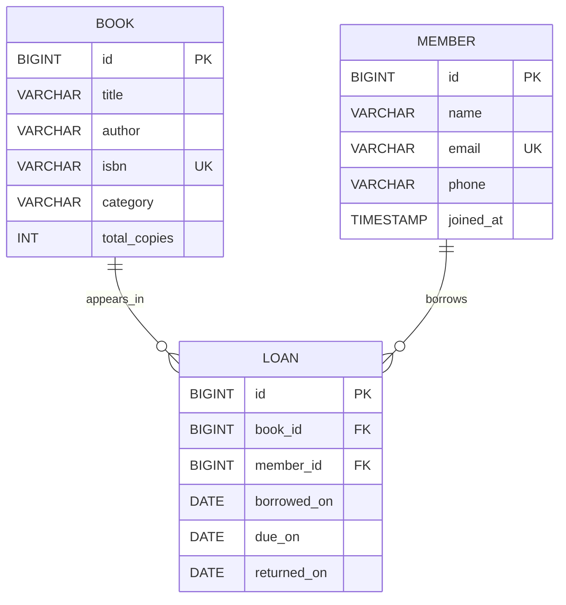

# Database design

## Entity relationship diagram

## Relationships and rules

- A book may appear in many loans over time; each loan refers to exactly one book.
- A member may have many loans over time; each loan refers to exactly one member.
- `returned_on IS NULL` means that the loan is active.
- Available copies are calculated as `total_copies - active loan count`.
- An issue operation only succeeds when at least one copy is available.
- ISBN and member email are unique; foreign keys prevent orphan loan rows.
- Due date is two weeks after issue date.

## Normalization

Book and member facts are stored once in their own tables. Loan rows hold only references plus circulation dates, avoiding repeated book/member details and supporting loan history.
